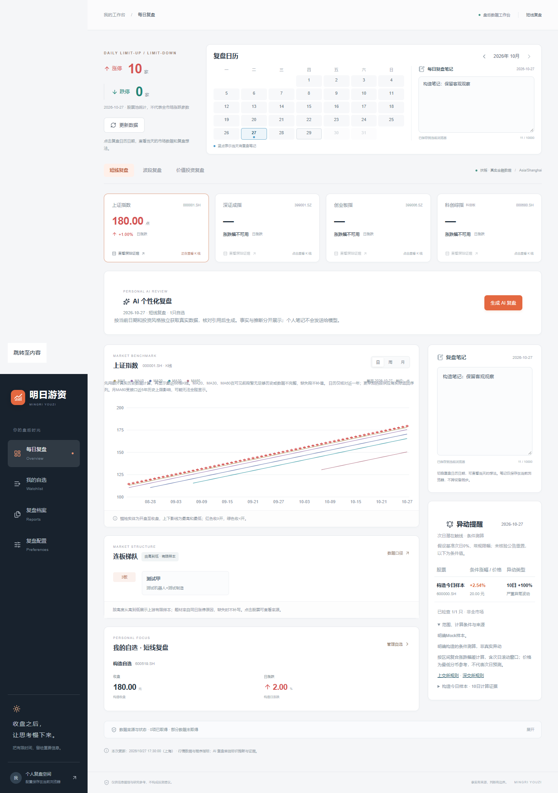

# 明日游资

面向 A 股个人投资者的个性化盘后复盘工具。当前已实现配置、真实数据 Dashboard、复盘日历/笔记，以及服务端 AI 个性化复盘与证据校验。真实模型是否可用取决于本地 OpenAI 密钥、账户权限及实际调用结果。

## 启动

需要 Node.js ≥20.9 和 npm。

```text
npm ci
```

复制 `.env.example` 为 `.env.local`，保留金融数据配置并私密配置 `FUYAO_API_KEY` 与 `OPENAI_API_KEY`；默认模型 `gpt-4.1-mini`，修改环境后重启服务。

```text
npm run dev
```

打开终端返回的本机 URL（默认 http://127.0.0.1:3000）。本次环境没有 npm 命令，已将官方 npm 临时装到忽略的 `.tools/package`；此工作区可用 `node .tools/package/bin/npm-cli.js run dev` 启动。该工具目录不作为源代码交付，其他环境直接使用正常 npm。

```text
npm run typecheck
npm test
npm run build
npm run start
```

若当前 Windows 环境的 Next.js 遥测配置写入发生跨设备错误，可设置 `NEXT_TELEMETRY_DISABLED=1` 后重试构建；无需修改用户全局配置。Vercel 使用标准 Next.js 配置，不需要静态导出。

## 已实现

- 首次投资风格选择、修改及切换，配置与自选股保存在当前浏览器。
- 展开的月度复盘日历；点击日期同步切换市场数据与每日笔记，有笔记的日期显示蓝点。
- 日历下方与右侧笔记区双向同步、按日期自动保存；刷新及跨标签页保留，保存失败明确提示。
- 连板梯队由高到低排列，仅显示股票名和同日涨停原因题材，不附代码/所属板块；缺失题材不编造。
- 扶摇真实标的搜索，自选股增删（本轮最多3只），刷新页面后保留。
- 按已收盘交易日请求真实数据的 Dashboard，四指数日/周/月蜡烛 K 线、均线和策略指标；顶部为真实涨跌停家数。
- 短线实际请求涨跌停池、连板矩阵；波段请求历史日线并计算均线、绝对成交量额及较前五日/上月同期差额；价值模式请求已披露年度/季度三表，程序计算同报告期同比、负债比例及现金流指标。
- 价值工作区支持年度/季度切换、相邻可见报表比较、指定时点估值和公告片段。后两项仅在实际接口返回并通过标的/时间/口径校验时展示，失败保持留空。
- 投资假设按自选股保存用户自设指标条件，支持修改留版本、逐日核验历史与JSON导出；条件变更使旧AI报告失效。用户假设文字与个人笔记不会发给模型。
- 关键指标证据弹窗：来源、字段、原始输入、口径、单位、时间和请求标识。
- 按日期/投资风格生成 AI 结构化报告，引用/数值/单位/对象/日期核对，事实、推断、不确定性分区；任务状态、防重复和切换取消。
- 报告生成后可主动“保存到复盘档案”，按日期/风格查看完整历史、版本、模型、配置快照和原证据；刷新保留，不自动保存或覆盖旧版本。
- 三个固定风格分别保存自定义AI复盘方式；留空/恢复默认回到默认逻辑，自定义模式通过受限取数规划及动态栏目生效，不能覆盖金融真实性、证据和合规规则。
- 指数均线先预热再截取可见K线，日/周尽量覆盖；月MA60受历史上限限制明确留空。第四指数为真实000680.SH科创综指。
- 明确的缺失/失败/不支持状态。没有模拟行情、模拟新闻、预置报告或静默回退。

## 环境变量

| 变量 | 用途 |
|---|---|
| FUYAO_API_KEY | 必需，服务端扶摇密钥；从不发给浏览器 |
| FUYAO_BASE_URL | 默认官方 HTTPS 地址；访问层限定官方主机 |
| DATA_REQUEST_TIMEOUT_MS | 单次数据请求超时，默认12000毫秒 |
| OPENAI_API_KEY / OPENAI_MODEL | 服务端 OpenAI Responses API；默认 gpt-4.1-mini，可配置账户可用且支持严格结构化输出的模型 |
| OPENAI_TIMEOUT_MS | 模型超时，默认45000毫秒，最大60000 |
| IFIND_ENABLED / IFIND_MCP_KEY | 设为true并私密配置独立iFinD密钥，启用公告片段/指定时点估值；初始化、目录、内层业务状态和结果字段都须校验 |
| IFIND_TIMEOUT_MS | iFinD各次请求等待，默认20000毫秒，受价值取数总预算约束 |
| DATABASE_URL | 未来账号/云存储适配预留；当前无数据库连接需求 |

`.env.local` 被忽略，不要提交。真实密钥不应进入 README、源码、日志或 NEXT_PUBLIC_ 变量。当前本地已配置扶摇、OpenAI及iFinD环境变量；Web运行时只读取环境变量，不读取用户技能目录。配置存在不代表实时连接成功。

## 范围与边界

配置、笔记及投资假设采用浏览器本地持久化，不跨设备同步，清理浏览器数据会移除记录。假设支持导出，当前最多10条活动条件、100个历史版本、5000条核验记录；超限或保存失败明确提示，已有记录不静默删除。没有全站共享用户自选文件。Dashboard 的金融数据按请求展示，不写入源码或部署文件。

AI 负责选择重要证据、组织观察和解释不确定性，金融数值由程序计算。Dashboard 已接入三种不同数据/指标/报告结构；事实只从服务端逐值核对过的证据字段生成，AI 推断始终明确标记待验证。

生成需要私密配置 OpenAI 密钥。生成任务仍只在有界内存临时保存；用户主动归档的报告保存在当前浏览器，完整快照可刷新查看，最多100份，清除浏览器数据会丢失，不跨设备同步。云端保存和反馈尚未实现。引用/数值校验不等于独立数源对账，规则过滤不保证覆盖全部自然语言违规表达；公网需要账号/限额/多实例任务治理。

历史估值适配器已实现，最新估值不冒充历史截面，是否有可用样本以本次查询和校验为准。财务报表按披露日期、期末、币种对齐；季度环比仅在实际取得匹配季度的单季字段、完成累计值和差分交叉核对后计算，否则显示“暂无可比环比数据”。归母净利润与合并净利润分开。公司历史行业归属、真实行业指数、合格行业资讯片段按来源分别呈现；缺产业信息不编造发展或政策。供应商历史修订、完整政策全文/行业景气数据库仍有边界。iFinD连接状态可能变化，以实际结果为准，成功样本不代表稳定可用。连板矩阵有样本上限；行业全量轮动和市场宽度尚未实现。

当前没有发布到公网。公开发布前需确认数据展示/缓存权限、配置部署凭据和访问/调用预算控制。不得输出确定性涨跌预测、收益承诺或直接买卖建议。

## 测试与记录

`npm test` 是纯函数与传输层测试，使用明确标注的构造输入，绝不进入产品分析。`npm run test:e2e` 使用本机 Edge，需先生产构建；测试包含模拟故障的 UI 检查和真实供应商连接检查。真实连接测试需要有效本地扶摇密钥、网络及额度，不保证离线通过；测试期间会产生供应商请求。

详见 [第二阶段架构](docs/architecture/第二阶段-MVP架构与范围.md)、[开发日志](docs/logs/开发日志.md)、[AI 使用记录](docs/logs/AI使用与验证记录.md)、[接口验证记录](docs/api/接口验证记录.md)、[测试记录](docs/tests/测试记录.md)。第一阶段原始记录未覆盖。

## AI 复盘验证与样例

在本机服务运行时执行 `node node_modules/tsx/dist/cli.mjs scripts/verify-ai.mts`：核验三种风格的真实数据证据包；如果配置了密钥，额外尝试一次真实 OpenAI 调用。真实金融内容和模型响应保存在忽略的 `.cache`，公开验证记录只保存状态与计数。没有密钥时明确记录未调用，不能声称真实 AI 分析成功。

[AI架构与边界](docs/architecture/AI复盘生成与证据校验.md)。`docs/examples/*-mock-review.json` 均为明确构造数据+模型 Mock 的测试示例，不是真实模型结果，不会作为产品预置报告；生成示例需要运行上面的验证脚本。

本轮档案、自定义方式、均线、报告去重、环比/行业及科创综指的结构与限制见[七项增量实现](docs/architecture/七项增量实现与验收.md)，实际修改文件与验证汇总见同日increment证据。旧阶段记录保留历史状态。

## 最新版本与界面预览

已完成客观复盘措辞、绝对成交量额、价值模式公共行情优先及右侧笔记/异动提醒调整，详见[实现与边界](docs/architecture/客观复盘与异动提醒.md)。异动仅对自选优先及涨停池最多30只做条件测算，默认基准下一交易日0%，尚未完整核验公告重置；不能当成全市场或交易所确认名单。

最近完整验证：类型检查、生产构建通过，140项单元测试及19项浏览器测试通过。单元与部分浏览器用例使用明确构造数据；真实金融接口及真实模型结果单独记录，不把Mock算成真实AI成功。

[查看截图及说明](docs/screenshots/README.md)。截图全部来自构造数据/模型Mock的隔离浏览器测试，不包含真实账户、每日笔记、金融接口原文或真实AI报告。



## 仓库安全与本地复验

仓库只提交源码、依赖锁文件、环境变量空模板、开发/AI/接口验证/测试记录及公开验证元数据。`.env.local`、依赖、缓存、构建产物和完整真实数据/模型响应不提交。其他电脑需要自行安装依赖并配置密钥，仓库内容不会携带本机密钥或浏览器档案。

在本地暂存准备提交的文件后执行 `node scripts/audit-upload.mjs`，检查暂存区及当前全部可达Git历史，覆盖已配置凭据精确匹配、常见令牌/私钥模式、敏感文件路径及公开证据内的原始金融数据。审计只输出文件位置/计数，不打印匹配到的凭据；结果保存到被忽略的`.cache`。这不是GitHub全历史或未来提交的自动安全保证。
